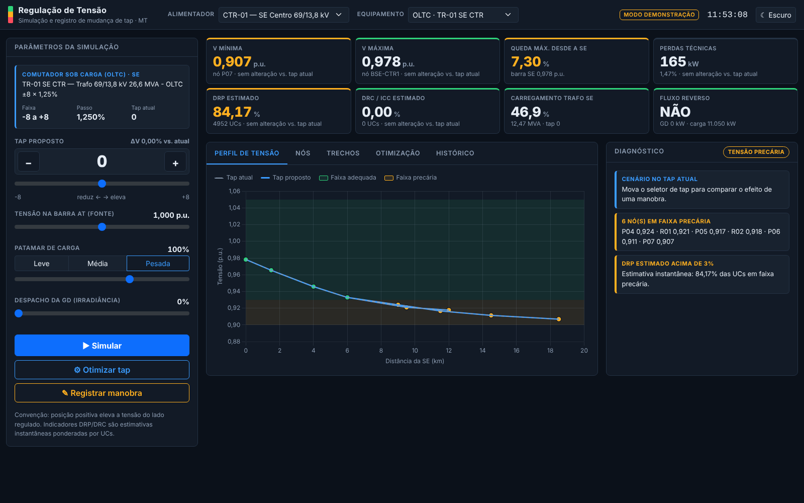
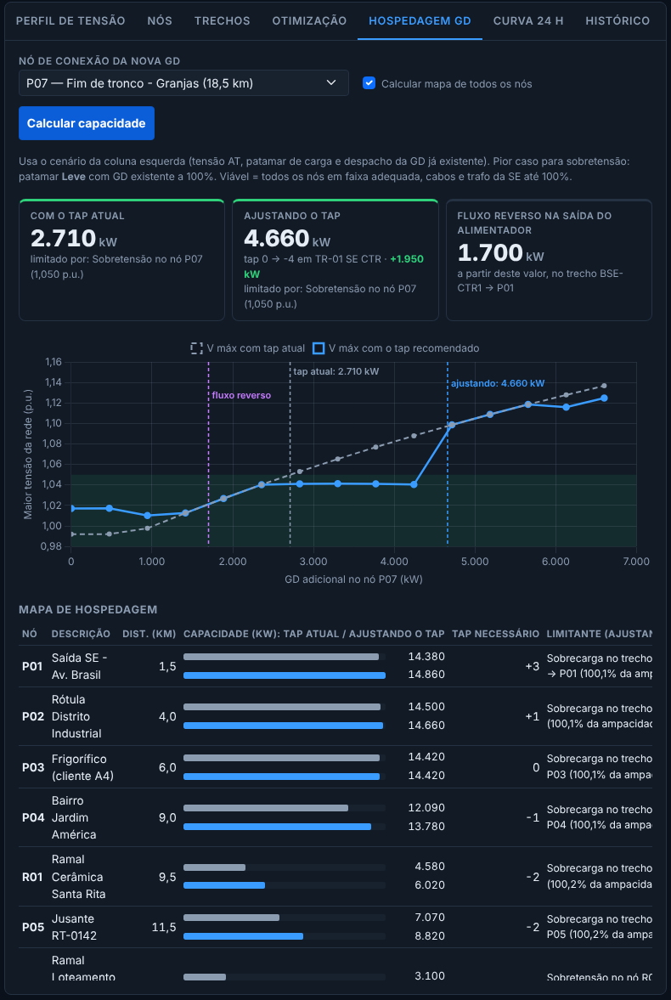
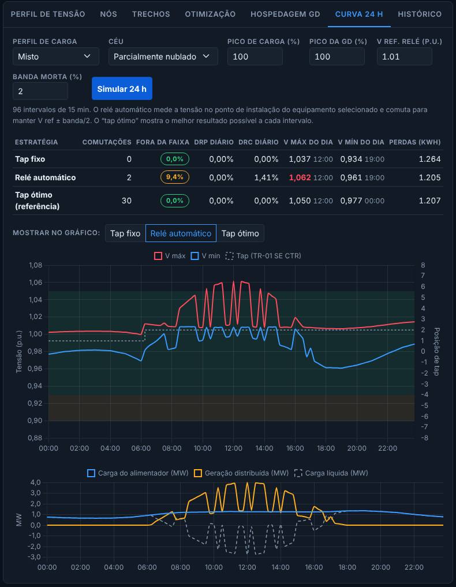

# ⚡ BrProjetcEletric · Simulador de Fluxo Reverso, GD e Correção de Tap

Ferramentas web para analisar o impacto da Geração Distribuída (GD) na tensão das redes de
distribuição e escolher a posição de tap que mantém os consumidores dentro dos limites do
**PRODIST Módulo 8**.

O repositório tem duas versões:

| | Protótipo Flask (raiz) | Versão PHP 5.5 ([`php/`](php/)) |
|---|---|---|
| Objetivo | Demonstrar fluxo reverso e sobretensão causados pela GD | Apoio à decisão em centro de operação (COI) |
| Rede | Fixa: trafo 13,8/0,38 kV de 100 kVA e 3 postes BT | Alimentadores MT de qualquer tamanho, cadastrados no banco |
| Regulação | Tap do trafo de distribuição (−2 a +2 × 2,5%) | OLTC da subestação + reguladores de linha |
| Motor | pandapower (Newton-Raphson) | Fluxo de carga radial próprio em PHP, validado contra o pandapower |
| Indicadores | Subtensão/sobretensão (0,93–1,05 p.u.) | Faixas adequada/precária/crítica, DRP/DRC/ICC estimados por UC, perdas |
| Estudos de GD | Fluxo reverso e sobretensão no cenário atual | Capacidade de hospedagem por nó e simulação de 24 h com comutações |
| Persistência | Nenhuma | MySQL ou PostgreSQL, histórico auditável de manobras |
| Servidor | Python 3 + Flask | PHP 5.5+ (servidores legados), sem dependências externas |

---

## Protótipo Flask

### Funcionalidades
- **Fluxo de carga em tempo real** com pandapower ao mover os controles de carga, GD e tensão da SE.
- **Detecção de fluxo reverso** no transformador e nas linhas quando a GD supera o consumo local.
- **Diagnóstico PRODIST** de subtensão (< 0,93 p.u.) e sobretensão (> 1,05 p.u.).
- **Otimização de tap**: testa as posições −2 a +2 e recomenda a de menor desvio em relação a 1,0 p.u.
- **Diagrama unifilar** com sentido do fluxo em cada trecho.

> **Convenção de tap:** o comutador está no lado de alta (`tap_side='hv'`).
> Tap **positivo reduz** a tensão na BT; tap negativo eleva.

### Como executar

```bash
git clone https://github.com/breletricidadegomes/proj_correcao_de_taps.git
cd proj_correcao_de_taps
python -m venv .venv
source .venv/bin/activate        # Windows: .venv\Scripts\activate
pip install -r requirements.txt
python app.py
```

Abra <http://localhost:8080>.

> **Segurança:** por padrão o servidor só aceita conexões deste computador e o depurador
> do Flask fica desligado. Para liberar na rede local (só em rede confiável):
> `SIMULADOR_HOST=0.0.0.0 python app.py`. Para depurar: `SIMULADOR_DEBUG=1 python app.py`
> (o app se recusa a ligar o depurador com o servidor aberto na rede).

### Testes

```bash
python -m pytest -q
```

Os testes verificam a página inicial, a simulação, o fluxo reverso com GD alta e, principalmente,
que **cada posição de tap produz uma tensão diferente**.

### Estrutura

```
app.py                  Servidor Flask + modelo da rede no pandapower
templates/index.html    Interface (Tailwind CSS + Chart.js)
static/js/app.js        Requisições à API, gráficos, tabelas e diagrama unifilar
tests/                  Testes automatizados (pytest)
requirements.txt        Dependências
```

### API

| Rota | Método | Corpo (JSON) | Retorno |
|---|---|---|---|
| `/api/simulate` | POST | `vm_pu`, `gd_kw`, `load_a_kw`, `load_b_kw`, `load_c_kw`, `tap_pos` (opcional) | Barramentos, linhas, trafo, totais e flag de fluxo reverso |
| `/api/optimize_tap` | POST | mesmos parâmetros | Resultado de cada posição e `best_tap` |

---

## Versão PHP 5.5 para centros de operação

Evolução do protótipo para alimentadores de média tensão reais, pensada para rodar na intranet da
distribuidora em servidores PHP legados.



- Painel com modo escuro, perfil de tensão (tap atual × proposto), tabelas de nós e trechos.
- Otimização de tap ponderada por número de consumidores e por desgaste do comutador.
- Registro de manobra com operador, motivo e indicadores antes/depois recalculados no servidor.
- **Capacidade de hospedagem de GD**: quantos kW cada nó aceita com o tap atual e ajustando o tap, o fator que limita (sobretensão, cabo, trafo) e a partir de quanto aparece fluxo reverso.
- **Simulação de 24 h**: compara tap fixo, relé automático e tap ótimo em 96 intervalos, com comutações do dia, DRP/DRC diários e perdas.
- Funciona sem banco (modo demonstração) ou com MySQL/PostgreSQL.



No fim do tronco do CTR-01, com carga leve, cabem 2.710 kW de GD com o tap atual;
baixando o OLTC para −4, o limite sobe para 4.660 kW. Perto da SE o limite deixa de ser
tensão e passa a ser a ampacidade do cabo.



No CTR-02, com a usina FV e nuvens passageiras, o relé automático do OLTC mantém a
barra da SE na faixa, mas o fim da linha chega a 1,062 p.u. ao meio-dia. O tap ótimo
evita a violação ao custo de 30 comutações no dia, contra 2 do relé.

Instalação, modelo de cálculo e cadastro da rede: [`php/README.md`](php/README.md).

---

## Tecnologias
- **Flask:** Python, pandapower, pandas, Flask, Tailwind CSS, Chart.js.
- **PHP:** PHP 5.5+, PDO (MySQL/PostgreSQL), Bootstrap 5.3, Chart.js 4.

## Autor
Bruno Gomes · Analista de Distribuição de Energia Elétrica
